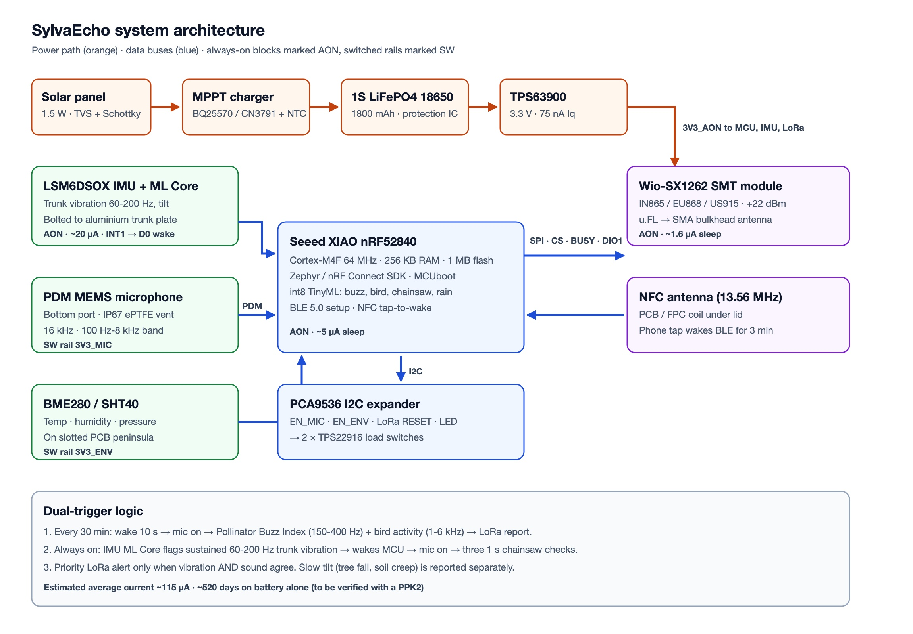
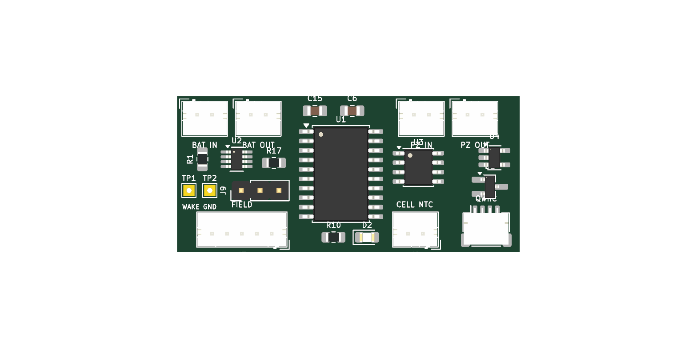
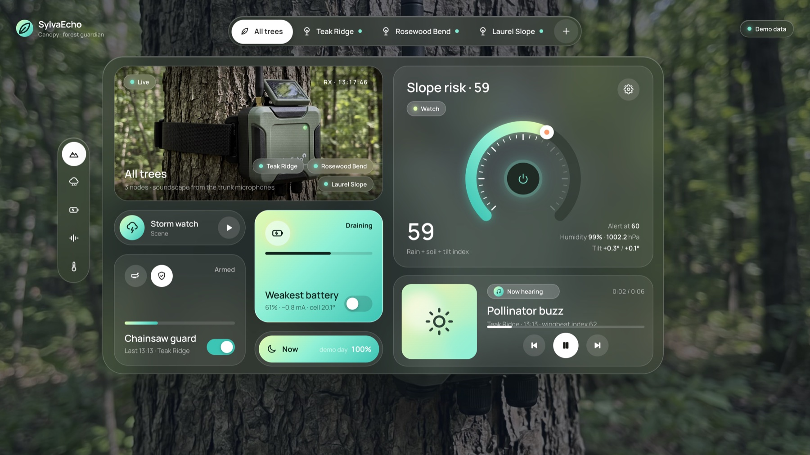

# SylvaEcho

A solar-powered LoRa sensor that straps to a tree trunk. It listens for pollinators and birds, detects illegal logging, and reports when a tree or slope starts to lean. It runs without mobile coverage, for forest departments, researchers, farms and citizen scientists.


This is an open hardware project for the [EasyEDA Spark 2026](https://oshwlab.com/activities/easyeda-spark-2026) competition. The PCB is designed in EasyEDA Pro.

## What it does

- **Biodiversity by sound.** Every 30 minutes the node wakes for 10 seconds, powers its microphone and scores pollinator buzz (150–400 Hz) and bird activity (1–6 kHz) on the nRF52840.
- **Illegal logging alerts.** A piezo disc on the trunk plate feeds a band-pass filter and a nanopower comparator. Sustained trunk vibration wakes the MCU, which then checks the IMU and three 1-second audio clips for a chainsaw. An alert is sent only when both agree, which cuts false alarms from wind, rain and traffic.
- **Tilt monitoring.** The IMU tracks slow tilt from cutting, tree fall or soil creep.
- **Long range, no SIM.** Reports and alerts go out over LoRa (IN865, EU868 or US915).
- **Sealed setup.** An NFC tap wakes Bluetooth for configuration, so the enclosure never needs opening.

Between listening windows the microphone rail is switched off. The design target is an average current of about 115 µA.

## Hardware

| Function | Part |
|---|---|
| MCU + Bluetooth | Seeed XIAO nRF52840 |
| LoRa radio | Seeed Wio-SX1262 SMT module, up to +22 dBm, U.FL antenna |
| Microphone | Knowles SPH0641LU4H-1 PDM MEMS microphone (bottom port) |
| Motion / tilt | ST LSM6DSOX 6-axis IMU |
| Environment | Bosch BME680 on rev 0.4, BME280 on rev 0.3 (temperature, humidity, pressure) |
| Trunk vibration wake | Piezo disc + TLV7041 nanopower comparator |
| Solar harvesting | TI BQ25570 with MPPT, charging one LiFePO4 cell |
| 3.3 V supply | TI TPS63900 buck-boost |
| I/O expander | TI TCA9534 |
| Mic power switch | TI TPS22917 load switch |
| Expansion | Qwiic (JST-SH) I2C port, test points |

The board is 4-layer, 60 × 45 mm, 1.6 mm FR-4.

### Board versions

The two versions differ only in the environment sensor U5. Both sensors use the same pin order and the same I2C address (0x76), so the schematic, firmware and LoRa report are the same.

| Version | U5 | LCSC part | Footprint | Files |
|---|---|---|---|---|
| Rev 0.4 (current) | Bosch BME680 | C125972 | LGA-8, 3.0 × 3.0 mm, 0.8 mm pitch | `PCB/BME680_rev0.4/` |
| Rev 0.3 | Bosch BME280 | C92489 | LGA-8, 2.5 × 2.5 mm, 0.65 mm pitch | `PCB/BME280_rev0.3/` |

Rev 0.4 was made because the BME280 went out of stock at JLCPCB. The BME680 also has a gas (VOC) sensor; the firmware reads only temperature, humidity and pressure from it.



### Solar panel and battery

- **Battery:** one LiFePO4 cell, for example an IFR18500 (the enclosure size) or an IFR18650. The charger stops at 3.51 V and the system cuts off at about 2.8 V.
- **Solar panel:** 0.3–0.5 W with an open-circuit voltage (Voc) **below 3.1 V**. A 4-cell panel sold as "2 V" (Voc around 2.4–2.6 V) fits. Panels sold as "3 V" usually have a Voc of 3.5–3.6 V, which is too high for this charger setting.

## Companion board SC-1 (battery gauge, security, field sensors)

Rev 0.4 has no battery-voltage line to the MCU, so it cannot report how full the cell is. SC-1 fixes that without changing the main board: it plugs into the Qwiic port, and the battery and piezo cables pass through it.



| Block | Parts | What it does |
|---|---|---|
| Battery gauge | INA219 + 0.22 Ω shunt, ATtiny1616 | Battery voltage and current both ways; charge counting gives the battery % (corrected from the resting voltage at night) |
| Security | ATECC608B | Per-node key that cannot be read out; monotonic counter against replayed packets |
| Field sensors | 5-pin JST-PH: soil-moisture probe, soil NTC, rain gauge; 2-pin cell NTC | Landslide (slope-risk) index together with the main board tilt |
| Trunk sound | MCP6001, 0.5–3.4 kHz, gain 101 | Night listening for wood-boring larvae (red palm weevil) |

- I2C addresses on the main bus: ATtiny1616 0x2A, ATECC608B 0x60. The INA219 sits on the ATtiny's private bus and is powered only while sampling.
- 46 × 21 mm, 2 layers. ICs and connectors on top, 0805 passives on the bottom: everything is hand-solderable.
- Program the ATtiny over UPDI (J9) with a USB-serial adapter (SerialUPDI).
- Files: `PCB/Companion_SC1/` (EasyEDA Pro project, fabrication files, KiCad source and the scripts that generate it).
- v0.2 layout: passives spread with routing channels, every GND pad has its own via to the GND pours, signals routed with EasyEDA's JRouter. Schematic and PCB are linked (all 48 footprints assigned) and EasyEDA's DRC reports no issues.

## Repository layout

```
PCB/
  BME680_rev0.4/
    easyeda/      EasyEDA Pro project, rev 0.4 (schematic and routed PCB)
    fabrication/  Gerber files, JLCPCB BOM and pick-and-place files
  BME280_rev0.3/
    easyeda/      EasyEDA Pro project, rev 0.3
    fabrication/  Gerber files, JLCPCB BOM and pick-and-place files
  Companion_SC1/
    easyeda/      EasyEDA Pro project (.epro2) for the SC-1 add-on board
    fabrication/  Gerber files and the hand-solder BOM
    kicad_source/ Generated KiCad schematic/PCB and schematic PDF
    tools/        Generators and EasyEDA scripts used to build it
  footprints/     Custom KiCad footprints (XIAO SMD, mic, jumper, test point, mounting hole)
  schematic/      Original KiCad schematic (BME280), netlist, BOM and PDF
Firmware/         Zephyr firmware for the XIAO nRF52840 node (both board versions)
  variants/       Environment sensor overlay for each board version
SC1_Firmware/     ATtiny1616 co-processor firmware for the SC-1 add-on (PlatformIO)
Gateway/          XIAO ESP32S3 + Wio-SX1262 gateway: LoRa to USB serial, MQTT and HTTP (PlatformIO, Arduino)
Gateway_zephyr/   Same gateway on Zephyr RTOS: LoRa to USB serial and MQTT (shares Gateway/src/decode.cpp)
Dashboard/
  backend/        Python FastAPI + SQLite: ingest (HTTP/MQTT), history, alerts, settings, live WebSocket
  frontend/       Next.js "Canopy" dashboard: spatial glass UI over the forest
Images/           Renders, block diagram and schematic preview
```

## Building the firmware

The firmware uses Zephyr (nRF Connect SDK).

```
west build -b xiao_ble/nrf52840 Firmware
west flash
```

This builds for rev 0.4 (BME680). For a rev 0.3 board (BME280):

```
west build -b xiao_ble/nrf52840 Firmware -- -DSENSOR=bme280
```

Run `west build -p` after switching between the two so the build directory is regenerated.

Schedule, detection thresholds and LoRa settings are in `Firmware/src/config.h`. The default LoRa channel is 865.0625 MHz (IN865); change it for EU868 or US915. Logs go out over Segger RTT, because the UART pins are used by the microphone.

The node finds the SC-1 add-on at boot (I2C 0x2A) and works the same without it. With SC-1 fitted, every report carries a 24-byte extension (battery, cell and soil temperature, soil moisture, rain totals, borer index), and an SC-1 pulse on WAKE_N (optional TP1 to TP6 wire) sends a `sc1_alert` report for heavy rain, low battery or borer activity.

### SC-1 co-processor (ATtiny1616)

```
cd SC1_Firmware
pio run                                                 # build
pio run -t upload --upload-port /dev/cu.usbserial-XXXX  # flash over UPDI (J9)
```

Flash it with SerialUPDI: a 3.3 V USB-serial adapter with a 4.7k resistor from TX to RX, RX to J9 pin 1 (UPDI), plus 3V3 and GND. The register map is in `SC1_Firmware/src/sc1_regs.h` (the node uses an identical copy). Defaults, all changeable over I2C and saved with command 0xA5: 1000 mAh cell, battery sampled every 60 s, soil and NTCs every 30 min, rain alert at 50 tips (10 mm) per hour, low battery at 15 %, borer listen 20 s after each node report.

Battery % is a coulomb count from INA219 samples, reset at full charge and corrected from the resting LiFePO4 voltage near empty and full. The INA219 is powered only while sampling, so short LoRa transmit peaks between samples are missed; treat the % as an estimate until it has been checked against a bench discharge.

### Gateway (XIAO ESP32S3 + Wio-SX1262)

```
cd Gateway
cp src/secrets.example.h src/secrets.h   # Wi-Fi, MQTT broker and/or HTTP URL
pio run -t upload
pio device monitor                       # one JSON line per packet
```

It listens on the same channel as the node (865.0625 MHz, SF10, BW 125 kHz, CR 4/5, private sync word) and drops repeated packets by node and sequence number. Each report is printed on USB serial, published to MQTT as `sylvaecho/<node>/<type>`, and/or POSTed as JSON to `HTTP_URL`. Leave the MQTT host and HTTP URL empty for serial output only.

### Gateway on Zephyr (alternative)

```
cp Gateway_zephyr/secrets.conf.example Gateway_zephyr/secrets.conf   # Wi-Fi and MQTT
west build -b xiao_esp32s3/esp32s3/procpu Gateway_zephyr
west blobs fetch hal_espressif      # once, for the ESP32 Wi-Fi driver
west flash
```

Same radio settings, JSON output and MQTT topics as the Arduino gateway, using Zephyr's own SX1262 driver (`lora_recv_async`), Wi-Fi management, DHCP and MQTT client. It has no HTTP POST yet. Pins are in `Gateway_zephyr/boards/xiao_esp32s3_esp32s3_procpu.overlay`.

### Report format

19-byte base report (unchanged), with byte 18 = extension flags. When bit 0 is set, the 24-byte SC-1 block follows (43 bytes in total). The full layout is in `Firmware/src/payload.h`; the gateway decoder is `Gateway/src/decode.cpp`.

## Dashboard

```
cd Dashboard/backend
python3 -m venv .venv && .venv/bin/pip install -r requirements.txt
DEMO=1 .venv/bin/uvicorn app:app --port 8000     # DEMO=1 simulates three trees

cd Dashboard/frontend
npm install && npm run dev                      # http://localhost:3000
```

The backend stores every report in SQLite and pushes it to the browser over a WebSocket. Reports arrive from the Arduino gateway's HTTP POST (`HTTP_URL = "http://<pc>:8000/api/ingest"`, optional `INGEST_TOKEN`) or from MQTT (`MQTT_HOST=<broker>` subscribes to `sylvaecho/+/+`, which works with both gateways). Demo data is labelled "Demo data" in the corner and `"demo": true` in the API; leave `DEMO` unset for real nodes.



The front end is a spatial glass window over the forest photo, with mouse parallax and a fluid 1440 x 810 layout (a stacked layout on phones):

- **Tabs:** all trees, or one tree each. Switching wipes the node view and rolls the card titles.
- **Rail:** what the dial shows: slope risk, rain, battery, bird activity, temperature.
- **Dial:** the live value as a mint arc. Drag the white knob to set that metric's alert level (saved on the server). The centre button mutes alerts on this screen.
- **Node view:** the device photo with a live spectrogram drawn from the pollinator, bird and chainsaw scores. Click it to fill the window.
- **Storm watch:** tightens the rain and risk alerts and switches to the rain view.
- **Chainsaw guard:** arm or disarm alerts. A confirmed logging alert turns the card red.
- **Battery:** the SC-1 state of charge, current and cell temperature.
- **Timeline:** drag back through the last day. The forest behind the glass darkens for night hours.
- **Soundscape:** steps through recent highlights: dawn chorus, pollinators, rain, borer clicks and alerts.

Open `http://localhost:3000/?shot` for a flat, still layout for screenshots.

The slope-risk index (0-100) combines 24 h and 3-day rain, soil moisture and tree tilt. It is a screening heuristic for the dashboard, not a calibrated landslide model.

## Ordering the board

1. Open `PCB/BME680_rev0.4/easyeda/SylvaEcho_rev0.4_BME680.epro` in EasyEDA Pro (File > Import), or use the files in `PCB/BME680_rev0.4/fabrication/` directly. For the BME280 version use `PCB/BME280_rev0.3/`.
2. PCB: 4 layers, 1.6 mm, lead-free HASL.
3. Assembly (Standard PCBA, top side): upload the `JLC_BOM_*.csv` and `JLC_CPL_*.csv` files from the same folder. JLCPCB flags the SPH0641 microphone (U7) for a manual review after the order is placed.
4. Hand-solder the XIAO nRF52840 (M1) and the Wio-SX1262 module (M2) after assembly. C11 and C12 are optional antenna-matching parts and are not fitted by default.

## Status

| Item | State |
|---|---|
| Schematic | Rev 0.3 |
| PCB layout | Rev 0.4 (BME680) routed and DRC checked; rev 0.3 (BME280) kept |
| Prototype boards | Rev 0.4 at JLCPCB (5 PCBs, 2 assembled); Spark sponsorship coupon approved |
| Companion board SC-1 | v0.2: routed, DRC clean; 5 PCBs and parts ordered (Lion Circuits, Robu, Evelta), boards due early December 2026 |
| MVP | Being built on development boards with the same sensors |
| Firmware | Node: first version plus SC-1 support; detection thresholds are placeholders until the classifier is trained |
| SC-1 firmware | Builds (8.2 KB of 16 KB flash); waiting for boards to test on hardware |
| Gateway firmware | Arduino version builds for the XIAO ESP32S3; decoder checked against the node's packer on a PC. Zephyr version written, not yet built |
| Dashboard | Python backend and Next.js front end run with demo data; waiting for the gateway to feed real reports |
| Field test | Planned |

## License

Apache License 2.0. See [LICENSE](LICENSE).
