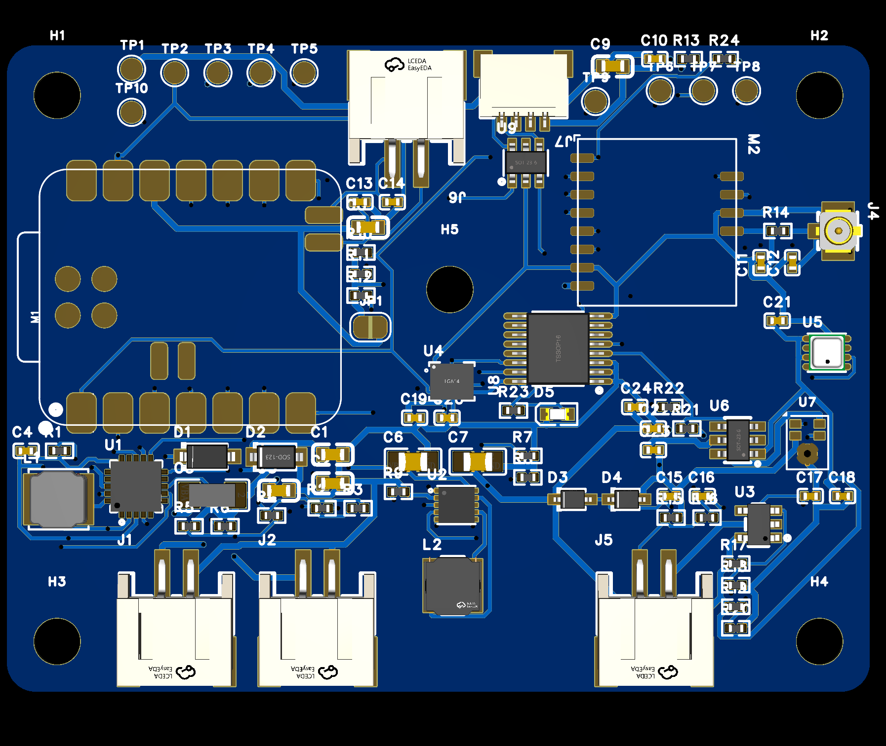

# SylvaEcho

A solar-powered LoRa sensor that straps to a tree trunk. It listens for pollinators and birds, detects illegal logging, and reports when a tree or slope starts to lean. It runs without mobile coverage, for forest departments, researchers, farms and citizen scientists.



This is an open hardware project for the [EasyEDA Spark 2026](https://oshwlab.com/activities/easyeda-spark-2026) competition. The PCB is designed in EasyEDA Pro.

## What it does

- **Biodiversity by sound.** Every 30 minutes the node wakes for 10 seconds, powers its microphone and scores pollinator buzz (150–400 Hz) and bird activity (1–6 kHz) on the nRF52840.
- **Illegal logging alerts.** A piezo disc on the trunk plate feeds a band-pass filter and a nanopower comparator. Sustained trunk vibration wakes the MCU, which then checks the IMU and three 1-second audio clips for a chainsaw. An alert is sent only when both agree, which cuts false alarms from wind, rain and traffic.
- **Tilt monitoring.** The IMU tracks slow tilt from cutting, tree fall or soil creep.
- **Long range, no SIM.** Reports and alerts go out over LoRa (IN865, EU868 or US915).
- **Sealed setup.** An NFC tap wakes Bluetooth for configuration, so the enclosure never needs opening.

Between listening windows the microphone rail is switched off. The design target is an average current of about 115 µA.

## Hardware

| Function | Part |
|---|---|
| MCU + Bluetooth | Seeed XIAO nRF52840 |
| LoRa radio | Seeed Wio-SX1262 SMT module, up to +22 dBm, U.FL antenna |
| Microphone | Knowles SPH0641LU4H-1 PDM MEMS microphone (bottom port) |
| Motion / tilt | ST LSM6DSOX 6-axis IMU |
| Environment | Bosch BME280 (temperature, humidity, pressure) |
| Trunk vibration wake | Piezo disc + TLV7041 nanopower comparator |
| Solar harvesting | TI BQ25570 with MPPT, charging a LiFePO4 18650 |
| 3.3 V supply | TI TPS63900 buck-boost |
| I/O expander | TI TCA9534 |
| Mic power switch | TI TPS22917 load switch |
| Expansion | Qwiic (JST-SH) I2C port, test points |

The board is 4-layer, 60 × 45 mm, 1.6 mm FR-4.


### Solar panel and battery

- **Battery:** one LiFePO4 18650 cell. The charger stops at 3.51 V and the system cuts off at about 2.8 V.
- **Solar panel:** 0.3–0.5 W with an open-circuit voltage (Voc) **below 3.1 V**. A 4-cell panel sold as "2 V" (Voc around 2.4–2.6 V) fits. Panels sold as "3 V" usually have a Voc of 3.5–3.6 V, which is too high for this charger setting.

## Repository layout

```
PCB/
  easyeda/        EasyEDA Pro project (schematic and routed PCB)
  fabrication/    Gerber files, JLCPCB BOM and pick-and-place files
  footprints/     Custom KiCad footprints (XIAO SMD, mic, jumper, test point, mounting hole)
  schematic/      KiCad schematic, netlist, BOM and PDF
Firmware/         Zephyr firmware for the XIAO nRF52840
Images/           Renders, block diagram and schematic preview
```

## Building the firmware

The firmware uses Zephyr (nRF Connect SDK).

```
west build -b xiao_ble/nrf52840 Firmware
west flash
```

Schedule, detection thresholds and LoRa settings are in `Firmware/src/config.h`. The default LoRa channel is 865.0625 MHz (IN865); change it for EU868 or US915. Logs go out over Segger RTT, because the UART pins are used by the microphone.

## Ordering the board

1. Open `PCB/easyeda/SylvaEcho_rev0.3.epro` in EasyEDA Pro (File > Import), or use the files in `PCB/fabrication/` directly.
2. PCB: 4 layers, 1.6 mm, lead-free HASL.
3. Assembly: upload `JLC_BOM_SylvaEcho_PCB2.csv` and `JLC_CPL_SylvaEcho_PCB2.csv`. All placed parts are on the top side.
4. Hand-solder the XIAO nRF52840 (M1) and the Wio-SX1262 module (M2) after assembly. C11 and C12 are optional antenna-matching parts and are not fitted by default.

## Status

| Item | State |
|---|---|
| Schematic | Rev 0.3 |
| PCB layout | Routed, DRC checked |
| Prototype boards | Quoted at JLCPCB (5 PCBs, 2 assembled), waiting for sponsorship approval |
| MVP | Being built on development boards with the same sensors |
| Firmware | First version; detection thresholds are placeholders until the classifier is trained |
| Field test | Planned |

## License

Apache License 2.0. See [LICENSE](LICENSE).
